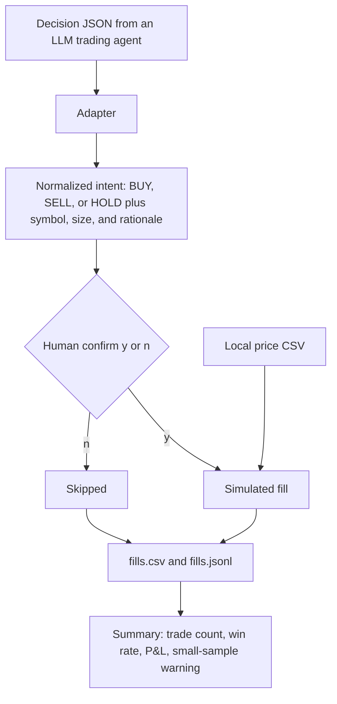

# Seduma Trade agent demo

A small MIT-licensed practice loop for people building LLM trading agents. Point it at a decision file — a TradingAgents-style export, an ai-hedge-fund-style export, or generic JSON — and it turns each decision into a normalized order intent, asks you to approve it, and writes a **simulated** fill against a local price CSV.

It does not call a model, download prices, or connect to a broker. There is no live trading in this repository.

> Not a broker or investment adviser. This demo does not pick or recommend trades. Simulated results are not a prediction of live performance. Not investment advice.

## 60-second quickstart

Requires Python 3.10 or newer. The run itself uses the standard library only. From a checkout of this repo:

```bash
python -m seduma_demo run \
  --agent tradingagents \
  --file examples/tradingagents_decisions.json \
  --practice-auto
```

That command reads `examples/tradingagents_decisions.json`, fills against `data/prices.csv`, and writes `results/fills.csv`, `results/fills.jsonl`, and `results/summary.json`. `--practice-auto` approves every intent without a prompt. The fills are still simulated.

You should see a `SIMULATED PRACTICE SUMMARY` with a trade count, a win rate, P&L, and a warning when the run has fewer than 30 simulated trades. The bundled file is smaller than that on purpose. The prices in `data/prices.csv` are illustrative numbers for the examples. They are not market data, and the printed P&L is only the simulator's arithmetic on that sheet.

Leave the flag off when you want the confirm gate:

```bash
python -m seduma_demo run \
  --agent generic \
  --file examples/generic_decisions.json
```

Each intent prints `SIMULATED approve ...? [y/n]`. `y` simulates the fill. `n` skips it. Nothing is sent anywhere.

Other bundled files:

```bash
python -m seduma_demo run \
  --agent ai-hedge-fund \
  --file examples/ai_hedge_fund_decisions.json \
  --practice-auto

python -m seduma_demo schema
```

Run the tests with:

```bash
pip install pytest
pytest
```

### Sample output

This is the quickstart command above, run on the bundled fixtures. The figures are the simulator's arithmetic on the illustrative prices in `data/prices.csv`. They are not a market result. The warning is there because five simulated trades is too small a sample to treat as a result.

```text
Seduma Trade practice demo
SIMULATED FILLS ONLY. No broker connection. No live trading.

Agent: tradingagents
Decisions: examples/tradingagents_decisions.json
Prices: data/prices.csv
Mode: practice-auto
Slippage: 5 bps adverse
Fees: 1 bps
Starting cash: 100000
Sizing portfolio: 100000

1. BUY AAPL as of 2024-06-03
   rationale: Fixture trader proposal. This text is not a recommendation.
   reference close 190 on 2024-06-03
   size 10 shares
   approved (--practice-auto)
   SIMULATED fill 10 @ 190.095 fee 0.190095
2. BUY MSFT as of 2024-06-03
   rationale: Fixture trader proposal with a fixed share count. Not a recommendation.
   reference close 420 on 2024-06-03
   size 5 shares
   approved (--practice-auto)
   SIMULATED fill 5 @ 420.21 fee 0.210105
3. HOLD NVDA as of 2024-06-04
   rationale: Fixture portfolio decision: no position change. The two sides in this sample are balanced.
   reference close 121 on 2024-06-04
   approved (--practice-auto)
   acknowledged HOLD, no fill
4. BUY NVDA as of 2024-06-05
   rationale: Fixture using percent-of-portfolio sizing text. Not a recommendation.
   reference close 119.5 on 2024-06-05
   size 8.368201 shares
   approved (--practice-auto)
   SIMULATED fill 8.368201 @ 119.55975 fee 0.10005
5. SELL AAPL as of 2024-06-07
   rationale: Fixture sell of the sample long. Not a recommendation.
   reference close 195.5 on 2024-06-07
   size 10 shares
   approved (--practice-auto)
   SIMULATED fill 10 @ 195.40225 fee 0.19540225
   realized P&L 52.68700275
6. SELL MSFT as of 2024-06-07
   rationale: Fixture legacy rendered decision. Not a recommendation.
   reference close 408 on 2024-06-07
   size 5 shares
   approved (--practice-auto)
   SIMULATED fill 5 @ 407.796 fee 0.203898
   realized P&L -62.484003

SIMULATED PRACTICE SUMMARY
Trades: 5
Closed trades: 2
Wins: 1
Losses: 1
Flats: 0
Win rate: 50.00% of 2 closing sells
Realized P&L: -9.79700025
Unrealized P&L: 28.68865349
Total P&L: 18.89165324
Unrealized P&L uses the last supplied close and does not charge an exit fee.
Ending cash: 98989.60293024
Ending equity: 100018.89165324
Open positions: 8.368201 NVDA @ 123 (2024-06-07)
WARNING: fewer than 30 simulated trades (5 in this run). A sample this small is not something to read as a result.

Wrote results/fills.csv
Wrote results/fills.jsonl
Wrote results/summary.json

Not a broker or investment adviser. This demo does not pick or recommend trades. Simulated results are not a prediction of live performance. Not investment advice.
```

## How it works



`--practice-auto` takes the yes branch for every intent. It does not turn simulation off.

1. An adapter reads the file and emits order intents. A short or a cover is logged as unsupported and is not filled.
2. For a dated BUY or SELL, the fill looks up the newest `close` on or before that date. A decision with no date uses the latest close in the file. A BUY or SELL with no usable close is skipped.
3. The confirm gate asks for `y` or `n`, unless `--practice-auto` is set.
4. An approved BUY or SELL is filled against that close. Slippage is adverse: buys fill above the close, sells fill below it. The default is 5 bps. A fee is then charged on the fill notional. The default is 1 bp. Change either with `--slippage-bps` and `--fee-bps` (0 to 10000).
5. The account is long-only simulated cash. It starts at `--cash` (default 100000). A buy that does not fit is not filled. A sell larger than the open position is clipped to the open shares. HOLDs acknowledge and do not trade. Currency amounts in the log and summary are shown to at most 8 decimal places.
6. The log records every row with `label` `SIMULATED`. The summary counts BUY and SELL fills as trades. Win rate is the share of closing sells with positive realized P&L after fees. Open P&L is marked at the last close in the CSV and does not charge an exit fee. Fewer than 30 simulated trades always prints a warning.

`entry_price`, `stop_loss`, and `price_target` in a source file are not used. This loop does not watch stops, and it does not fill at the agent's stated entry.

### Adapters

This repo does not install or vendor those projects. The files under `examples/` are small fixtures that mimic published output shapes.

| `--agent` | What the file looks like | Source of the shape |
| --- | --- | --- |
| `tradingagents` | Trader proposal (`action`, `reasoning`, `position_sizing`), portfolio decision (`rating`, `executive_summary`, `investment_thesis`), or rendered text that contains `FINAL TRANSACTION PROPOSAL: **BUY**` | [TauricResearch/TradingAgents](https://github.com/TauricResearch/TradingAgents) |
| `ai-hedge-fund` | `{decisions: {TICKER: {action, quantity, confidence, reasoning}}}` | [virattt/ai-hedge-fund](https://github.com/virattt/ai-hedge-fund) |
| `generic` | `{decisions: [{symbol, side, size, rationale, date?}]}` | [`seduma_demo/generic_decision.schema.json`](seduma_demo/generic_decision.schema.json) |

Side mapping:

| Source action | Practice intent |
| --- | --- |
| Buy, buy, Overweight | BUY |
| Hold, hold | HOLD |
| Sell, sell, Underweight | SELL |
| short, cover | not simulated |

Size is a share count (`size`, `quantity`, `shares`, `10`, or `10 shares`) or a percent (`5%` or `5% of portfolio`). A percent is turned into shares with `--sizing-portfolio` (default: the starting cash) divided by the matched close, then rounded half up to 0.000001 share. HOLD does not use a size.

A TradingAgents fixture can be one object, an array, `{runs: [...]}`, or a map of ticker to decision. An optional `date` (`YYYY-MM-DD`) selects the price row. The ai-hedge-fund fixture accepts the same kind of optional `date` on the wrapper so the practice file can name a row in your CSV. That date is not part of the upstream decision object.

### CLI

```text
python -m seduma_demo run \
  --agent {tradingagents,ai-hedge-fund,generic} \
  --file PATH \
  [--prices data/prices.csv] \
  [--practice-auto] \
  [--slippage-bps 5] \
  [--fee-bps 1] \
  [--cash 100000] \
  [--sizing-portfolio 100000] \
  [--out results]
```

Run it from the repo root so the default price path resolves. `python -m seduma_demo schema` prints the generic schema. `python -m seduma_demo --help` prints the disclaimer.

The price CSV needs a header `date,symbol,close`. Lines starting with `#` are ignored. A duplicate date for a symbol keeps the last row.

## Limits

- Simulated fills only. This repository has no broker connection and no live-trading command. `--practice-auto` is still simulated.
- This is not a backtester. It does not walk a clock, model an order book, use volume, borrow shares, pay borrow, handle splits or dividends, or enforce a stop. It applies the decisions in file order to closes you put in a CSV.
- It does not pick or recommend trades. Rationale text is copied through from the file you provide.
- It does not call an LLM and it does not make network calls.
- Open P&L uses the last close in the sheet, even when that row is later than a fill. That is a mark against the file you supplied, not a point-in-time result.
- Win rate is only "how many closing sells in this run had positive realized P&L." A run with fewer than 30 simulated trades prints a warning because the sample is too small to treat as a result.
- Short and cover are not simulated. Overweight becomes BUY and Underweight becomes SELL, and the original word is kept on the log line.
- Fractional shares are allowed. Cash that cannot pay for a buy skips that buy.

## License

MIT. Copyright (c) 2026 Quantum Karate. See [LICENSE](LICENSE).

## Seduma Trade

Want a full local Practice console with connection labels and a confirm-gated Live boundary? Seduma Trade ($49 one time): https://payhip.com/b/K7UaW

Quantum Karate: https://quantum-karate.github.io/website/
